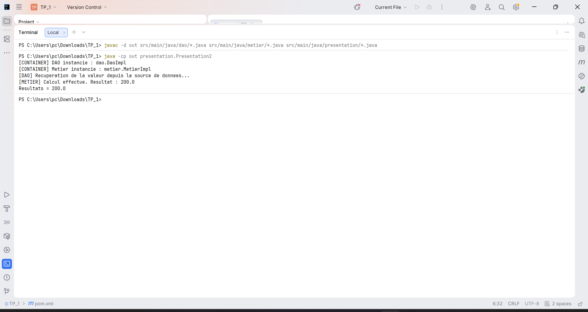

# TP - Programmation dynamique en Java

Ce projet illustre le chargement dynamique des classes avec l'API de reflexion Java. L'application lit les implementations a utiliser depuis un fichier de configuration, instancie les objets, puis injecte la dependance DAO dans la couche metier.

Avant la capture ci-dessous, le projet a ete compile depuis le terminal. Ensuite, la classe principale `presentation.Presentation2` a ete executee pour verifier le chargement dynamique, l'injection de dependance et le calcul final.

La capture montre que le conteneur instancie correctement la classe DAO et la classe metier, puis execute le calcul avec le resultat attendu.
