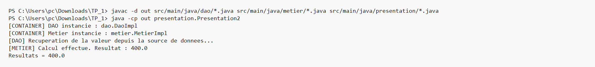
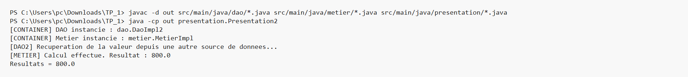

# TP - Programmation dynamique en Java

Ce projet illustre le chargement dynamique des classes avec l'API de reflexion Java. L'application lit les implementations a utiliser depuis un fichier de configuration, instancie les objets, puis injecte la dependance DAO dans la couche metier.

## Execution avec DaoImpl

Avant cette capture, le fichier de configuration pointe vers la premiere implementation DAO. L'execution montre que le conteneur charge `DaoImpl`, injecte cette dependance dans le metier, puis affiche le resultat du calcul.

## Execution avec DaoImpl2

Avant cette deuxieme capture, le fichier de configuration pointe vers la deuxieme implementation DAO. Sans modifier la couche metier, le programme charge `DaoImpl2` dynamiquement et produit un resultat different.

